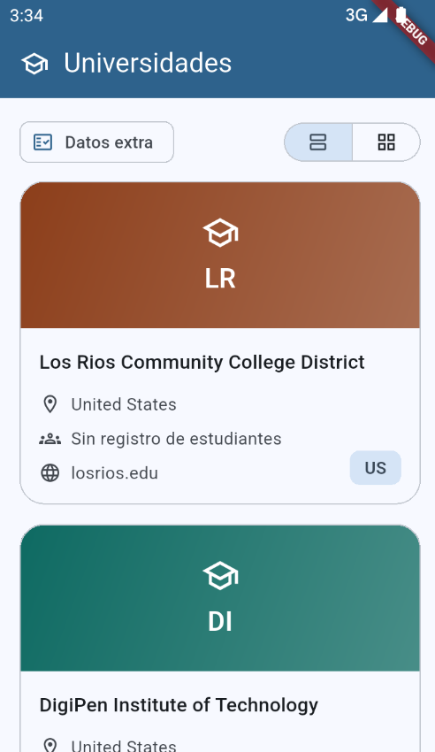
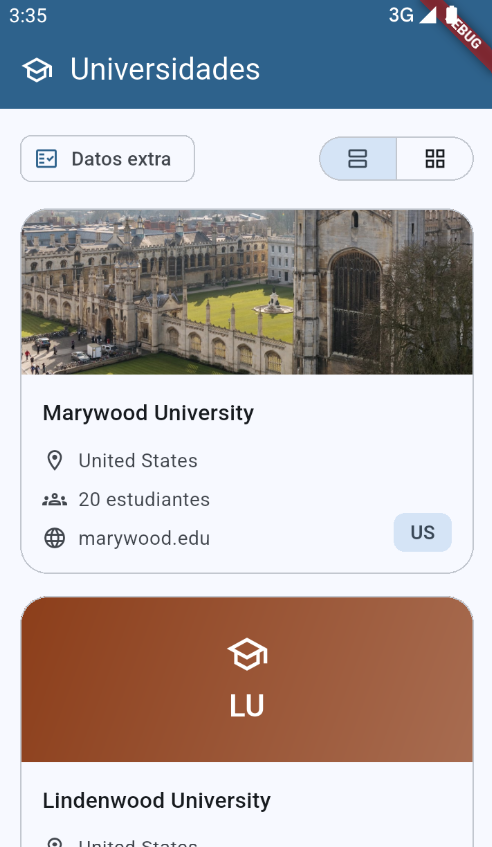
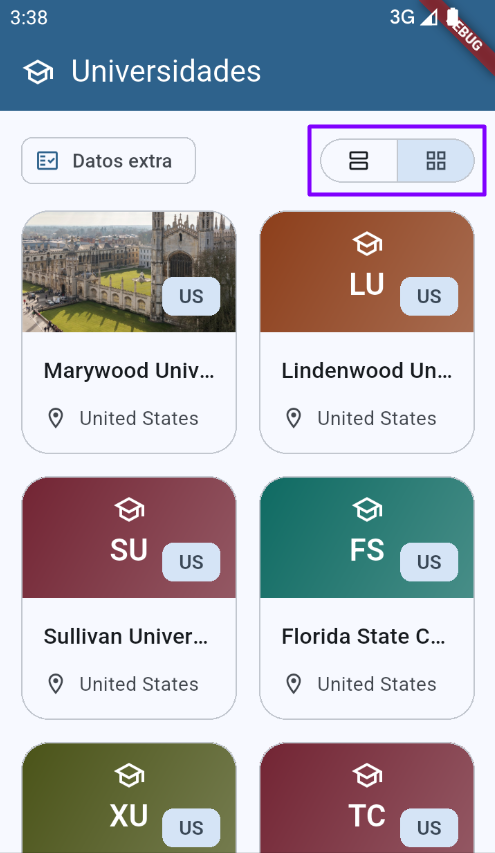
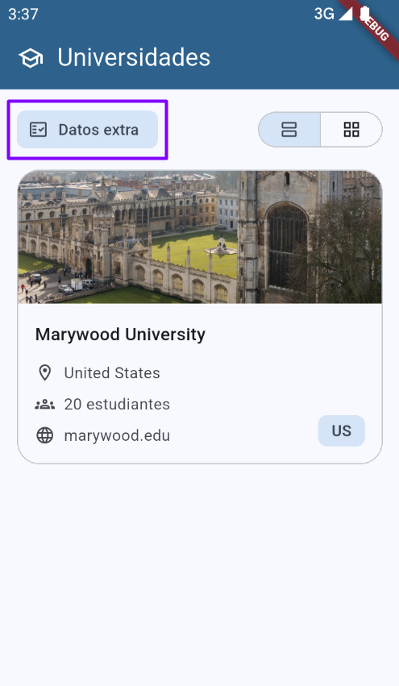
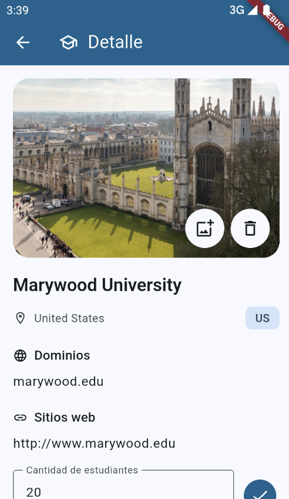
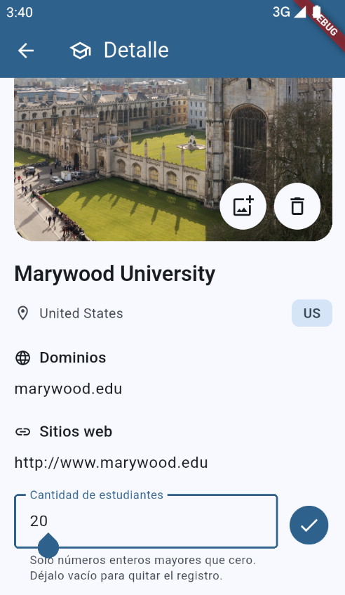

# 🎓 Universidades App

Aplicación Flutter que consulta un catálogo remoto de universidades y lo muestra en tarjetas. Desde el detalle de cada institución se puede asignar una imagen de la galería y registrar la cantidad de estudiantes. Esos datos extra se reflejan de inmediato en el listado.

La interfaz usa Material 3 con un color semilla azul (`#1B4D72`). El nombre visible de la app es **Universidades App**.

## 📱 Descripción

Al abrir la app se descarga el listado completo desde un JSON público. Cada universidad llega con nombre, país, provincia o estado, código de país de dos letras, dominios y sitios web.

La imagen y la cantidad de estudiantes no vienen en esa fuente. El usuario los agrega en la pantalla de detalle. La imagen se guarda en el directorio de documentos de la app. La cantidad de estudiantes se conserva en memoria mientras la sesión sigue abierta y vuelve a la tarjeta al guardar.

## ✨ Funcionalidades

- Descarga del catálogo remoto y caché en memoria para no repetir la petición durante la sesión.
- Estados de carga, error con botón **Reintentar** y listado vacío (**Sin datos**).
- Vista completa, una tarjeta por fila, y vista en cuadrícula de dos columnas.
- Filtro **Datos extra**, que deja visibles solo las universidades con imagen o con una cantidad de estudiantes mayor que cero.
- Transición suave al cambiar de vista o de filtro.
- Banner de cada tarjeta: foto guardada o un degradado con las iniciales del nombre.
- Detalle con dominios, sitios web, selector de imagen y editor de estudiantes.
- Validación de la cantidad: solo enteros mayores que cero, con un máximo de 9.999.999. El campo vacío quita el registro.
- Confirmación antes de retirar la imagen y borrado del archivo anterior al reemplazarla.

## 📸 Capturas de pantalla

### 📋 Lista principal

Vista completa al cargar el catálogo. Las tarjetas sin foto muestran un degradado según la inicial del nombre, el país, el estado de estudiantes y el primer dominio.



### 🖼️ Tarjeta con imagen

Después de guardar una foto y la cantidad de estudiantes, la tarjeta de la lista muestra la imagen y el conteo formateado.



### 🔳 Vista en cuadrícula

El selector de la derecha cambia a dos columnas. En esta vista la tarjeta conserva el banner, el código de país, el nombre y la ubicación.



### 🔎 Filtro de datos extra

El chip **Datos extra** oculta las universidades que todavía no tienen imagen ni cantidad de estudiantes.



### 🏫 Detalle de la universidad

La pantalla de detalle muestra la imagen, el nombre, la ubicación, los dominios, los sitios web y la cantidad de estudiantes. Los botones de la imagen abren la galería o inician el retiro de la foto.



### ✏️ Edición de la cantidad de estudiantes

El campo acepta solo dígitos. El texto de ayuda indica que debe ser un entero mayor que cero y que dejarlo vacío quita el registro. El botón de confirmación guarda imagen y cantidad, y regresa al listado.



## 🏗️ Arquitectura

La app separa la interfaz, la orquestación y el acceso a datos:

```text
Pantallas y widgets
        │
        ▼
UniversityService          UniversityGalleryService
        │                          │
        ▼                          ▼
UniversityRepository         ImagePicker
        │
        ▼
JSON remoto

UniversityImageStorageService
        │
        ▼
Documentos de la app / university_images
```

`UniversitiesHomePage` conserva la vista y el filtro. `UniversityCardList` pide el catálogo, pinta las tarjetas y, al volver del detalle, reemplaza la universidad editada. `UniversityDetailPage` elige la imagen, valida los estudiantes y persiste el archivo antes de devolver el modelo actualizado.

## 📁 Estructura del proyecto

```text
lib/
├── main.dart
├── config/
│   └── universities_api_url.dart
├── models/
│   └── university.dart
├── repositories/
│   └── university_repository.dart
├── services/
│   ├── university_service.dart
│   ├── university_gallery_service.dart
│   └── university_image_storage_service.dart
├── screens/
│   ├── universities_home_page.dart
│   └── university_detail_page.dart
└── widgets/
    ├── app_bar_component.dart
    ├── university_list_controls.dart
    ├── university_card_list.dart
    ├── university_card.dart
    └── university_image_banner.dart
docs/
└── screenshots/
```

Las carpetas `android/`, `ios/`, `web/`, `windows/`, `linux/` y `macos/` son los proyectos de plataforma que genera Flutter.

## 🚀 Punto de entrada

`lib/main.dart` arranca `MaterialApp` con el título **Universidades App**, el tema generado desde el color semilla y `UniversitiesHomePage` como pantalla inicial.

## 🌐 Configuración

`lib/config/universities_api_url.dart` concentra la URL del catálogo:

`https://tyba-assets.s3.amazonaws.com/FE-Engineer-test/universities.json`

El archivo remoto es una lista de objetos con `name`, `country`, `state-province`, `alpha_two_code`, `domains` y `web_pages`.

## 📦 Modelo

`lib/models/university.dart` representa una universidad.

| Campo | Origen | Uso |
| --- | --- | --- |
| `name` | JSON | Título de la tarjeta y del detalle |
| `country` | JSON | Ubicación |
| `stateProvince` | JSON (`state-province`) | Se muestra junto al país cuando viene informado |
| `alphaTwoCode` | JSON (`alpha_two_code`) | Chip de país, por ejemplo `US` |
| `domains` | JSON | Primer dominio en la tarjeta; lista completa en el detalle |
| `webPages` | JSON (`web_pages`) | Sitios web del detalle |
| `imageFileName` | Usuario | Nombre del archivo guardado en documentos |
| `studentCount` | Usuario | Cantidad de estudiantes |

`fromJson` arma el modelo con los datos remotos. `withUserProvidedData` reemplaza solo la imagen y la cantidad. `hasUserProvidedData` es verdadero cuando hay un nombre de archivo o una cantidad mayor que cero. Ese criterio alimenta el filtro **Datos extra**.

## 🗄️ Repositorio

`lib/repositories/university_repository.dart` hace la petición HTTP, exige un estado 200 y convierte cada objeto del JSON en `University`. Si la descarga o el parseo fallan, registra el error y lo vuelve a lanzar para que la lista muestre el estado de fallo.

## 🔧 Servicios

### UniversityService

`lib/services/university_service.dart` descarga el catálogo una sola vez y lo guarda en memoria. `replaceUniversity` sustituye una universidad por índice cuando el detalle devuelve datos nuevos. La cantidad de estudiantes vive en esa lista en memoria: se ve en las tarjetas de la sesión actual.

### UniversityGalleryService

`lib/services/university_gallery_service.dart` abre la galería con `image_picker` y devuelve el archivo elegido. Si el usuario cancela, devuelve `null`.

### UniversityImageStorageService

`lib/services/university_image_storage_service.dart` copia la imagen a `university_images`, dentro del directorio de documentos de la app. El nombre del archivo usa la marca de tiempo en microsegundos y conserva la extensión original. También localiza y borra archivos ya guardados. Al reemplazar una foto, el detalle elimina el archivo anterior.

## 🖥️ Pantallas

### Inicio

`lib/screens/universities_home_page.dart` compone la barra **Universidades**, los controles de filtro y vista, y la lista de tarjetas. El estado local guarda el modo (`full` o `grid`) y si el filtro de datos extra está activo.

### Detalle

`lib/screens/university_detail_page.dart` recibe una universidad y muestra:

- Banner de 220 px con botones para elegir o retirar la imagen.
- Nombre, ubicación y chip del código de país.
- Secciones **Dominios** y **Sitios web**. Si una lista llega vacía, se muestra **Sin dominio** o **Sin sitio web**.
- Campo **Cantidad de estudiantes** y botón de guardado.

Al confirmar, valida el formulario, copia la imagen nueva si hace falta, arma la universidad con `withUserProvidedData` y cierra la ruta devolviendo ese modelo. La lista lo aplica en el índice original. Durante el guardado los controles quedan bloqueados y el botón muestra un indicador.

Retirar la imagen pide confirmación en un diálogo. Cancelar deja la foto como estaba.

## 🧩 Widgets

### Barra superior

`lib/widgets/app_bar_component.dart` pinta una `AppBar` con el color primario del tema, un ícono y un título de una sola línea. En el inicio el título es **Universidades**. En el detalle es **Detalle**.

### Controles del listado

`lib/widgets/university_list_controls.dart` coloca a la izquierda el chip **Datos extra** y a la derecha un `SegmentedButton`:

- Icono de lista: vista completa.
- Icono de cuadrícula: vista de dos columnas.

### Lista de tarjetas

`lib/widgets/university_card_list.dart` es el dueño de la carga. Muestra el indicador circular, el mensaje de error con **Reintentar**, **Sin datos** o el scroll de tarjetas.

La vista completa limita el ancho a 480 px. La cuadrícula llega a 720 px y arma filas de dos tarjetas. Cambiar la vista o el filtro desvanece el contenido durante 180 ms y luego revela la selección nueva.

Al tocar una tarjeta abre `UniversityDetailPage`. Si esa ruta devuelve una universidad, actualiza la lista en memoria.

### Tarjeta

`lib/widgets/university_card.dart` define `UniversityCardLayout.full` y `UniversityCardLayout.grid`.

En vista completa muestra banner, nombre, ubicación, estudiantes, primer dominio y chip de país. La cantidad usa separador de miles con punto (`20` se lee tal cual; `20000` se muestra como `20.000 estudiantes`). Sin cantidad, el texto es **Sin registro de estudiantes**.

En cuadrícula muestra un banner más bajo, el chip de país sobre la imagen, el nombre y la ubicación.

### Banner de imagen

`lib/widgets/university_image_banner.dart` busca el archivo guardado y lo dibuja a pantalla completa dentro del banner. Si no hay archivo, pinta un degradado y las dos primeras iniciales del nombre, junto al ícono de birrete.

El color del degradado depende de la primera letra, ya normalizada si trae acento:

| Letras | Tono |
| --- | --- |
| A B C | Verde |
| D E F | Verde azulado |
| G H I | Ámbar |
| J K L | Naranja |
| M N O | Frambuesa |
| P Q R | Violeta |
| S T U | Granate |
| V W X Y Z | Oliva |

## 🔐 Permisos

- Android declara `INTERNET` para descargar el JSON.
- iOS incluye `NSPhotoLibraryUsageDescription`: *La app necesita acceder a tus fotos para asignar una imagen a la universidad.*

## 📦 Dependencias

| Paquete | Uso |
| --- | --- |
| `flutter` | SDK y Material |
| `cupertino_icons` | Iconos de estilo iOS |
| `http` | Descarga del catálogo |
| `image_picker` | Selección de imagen en la galería |
| `path_provider` | Directorio de documentos donde se guardan las fotos |
| `flutter_lints` | Reglas de análisis estático, solo en desarrollo |

La versión de la app es `1.0.0+1` y el SDK de Dart declarado es `^3.13.5`. El paquete no se publica en pub.dev (`publish_to: none`).

## ▶️ Cómo ejecutar

Requisitos: Flutter compatible con el SDK declarado y un dispositivo o emulador.

```bash
flutter pub get
flutter run
```

Para revisar el código sin lanzar la app:

```bash
flutter analyze
```

`analysis_options.yaml` incluye `package:flutter_lints/flutter.yaml` y excluye del análisis las carpetas `build`, `android` e `ios`.
